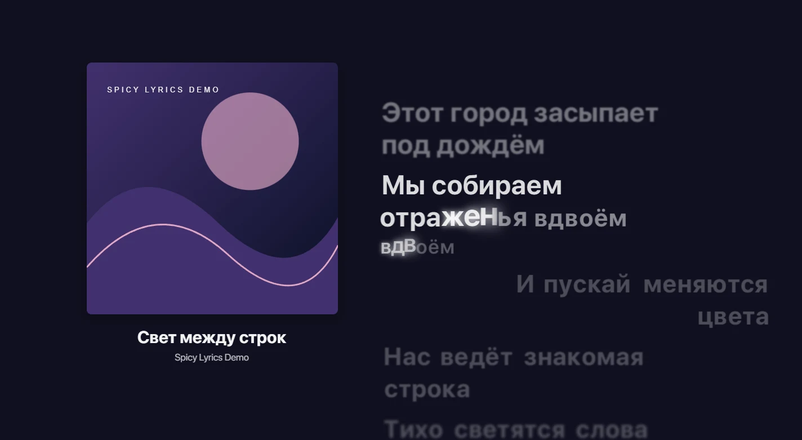
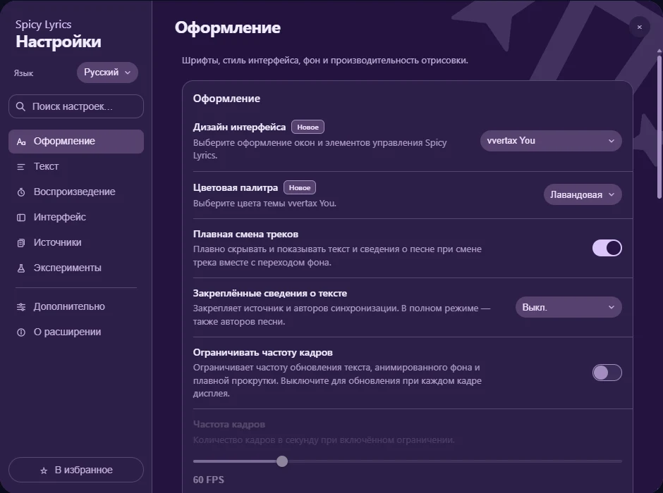
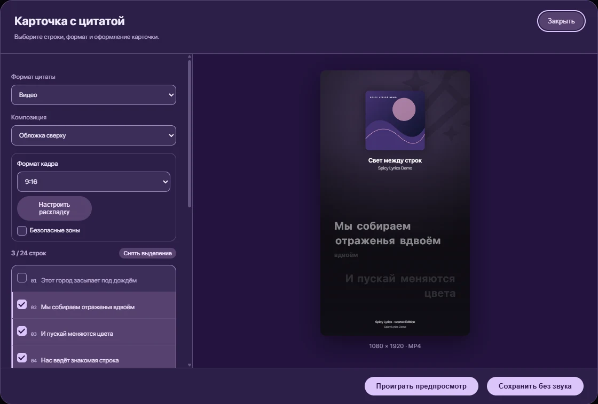

<p align="center">
  
</p>
<h1 align="center">Spicy Lyrics — vvertax Edition</h1>
<p align="center">Синхронизированные тексты, настраиваемые темы и видеоцитаты для настольного Spotify.</p>
<p align="center">
  <strong>Неофициальный форк <a href="https://github.com/Spikerko/spicy-lyrics">Spicy Lyrics от Spikerko</a>.</strong><br>
  Сделан для Spicetify с использованием наработок форков <a href="https://github.com/iPixelGalaxy/spicy-lyrics">iPixelGalaxy</a> и <a href="https://github.com/Ruytha/spicy-lyrics-ruytha-edition">Ruytha</a>.
</p>
<p align="center">
  <a href="./README.md">English</a> · <strong>Русский</strong>
</p>
<p align="center">
  <a href="#установка"><strong>Установить</strong></a> ·
  <a href="#текст-в-ритме-песни">Скриншоты</a> ·
  <a href="https://github.com/vvertax/spicy-lyrics/blob/main/CHANGELOG.md">Что нового</a>
</p>



## Установка

Нужны настольный Spotify и [Spicetify](https://spicetify.app). Перед установкой отключите другие версии расширения Spicy Lyrics.

1. Скачайте [`spicy-lyrics-sl.mjs`](https://lrc.vvrtx.lol/spicy-lyrics-sl.mjs) и положите его в папку **Extensions**. Команда `spicetify -c` покажет путь к файлу конфигурации. Папка находится рядом с ним.
2. Выполните команды.

   ```powershell
   spicetify config extensions spicy-lyrics-sl.mjs
   spicetify apply
   ```

При первом запуске загрузчик выбирает канал **vvertax Edition**. Проверка новой сборки происходит при запуске Spotify.

## Текст в ритме песни

Следите за словами и слогами в такт музыке, включая дуэты и бэк-вокалы. Оставьте плавающие субтитры, пока листаете Spotify, или откройте текст на весь экран в кинорежиме. Выбирайте между Spring и Bloom, переключайте источники и включайте романизацию, когда она доступна.

## Оформление под себя

**vvertax You** сочетает раскладку настроек Original Spicy Lyrics с цветами Material You. Выберите серую, лавандовую, зелёную или белую палитру либо создайте свою из одного HEX-цвета. Меняйте шрифты, скрывайте лишние настройки и выстраивайте быстрые кнопки перетаскиванием.



## Видеоцитаты

Создавайте PNG-карточки или экспортируйте ролики с анимацией текста. Один ролик может включать до 24 строк и длиться до 60 секунд. Подрежьте фрагмент, зациклите предпросмотр, выберите вертикальный, квадратный или широкий кадр и расположите обложку и текст. Добавьте аудиофайл или запишите звук Spotify, если доступна передача звука. Формат экспорта зависит от кодека в клиенте: MP4 или WebM.



## Инструменты для авторов текстов

- Загружайте TTML или LRC для отдельных треков и сохраняйте резервную копию своей библиотеки.
- Сравнивайте две версии TTML рядом на одной позиции воспроизведения.
- Оставляйте замечания к отдельным строкам и экспортируйте отчёт.

*Скриншоты сделаны в браузерном демо.*

## Сборка из исходников

Нужны Node.js 24 и npm.

```sh
npm ci
npm test
npm run build
```

Готовый файл — `dist/spicy-lyrics@<версия>.mjs`. Его можно установить напрямую, если нужна фиксированная локальная сборка.

## Лицензия

[AGPL v3](https://github.com/vvertax/spicy-lyrics/blob/main/LICENSE) · [Авторство](https://github.com/vvertax/spicy-lyrics/blob/main/NOTICE.md)
