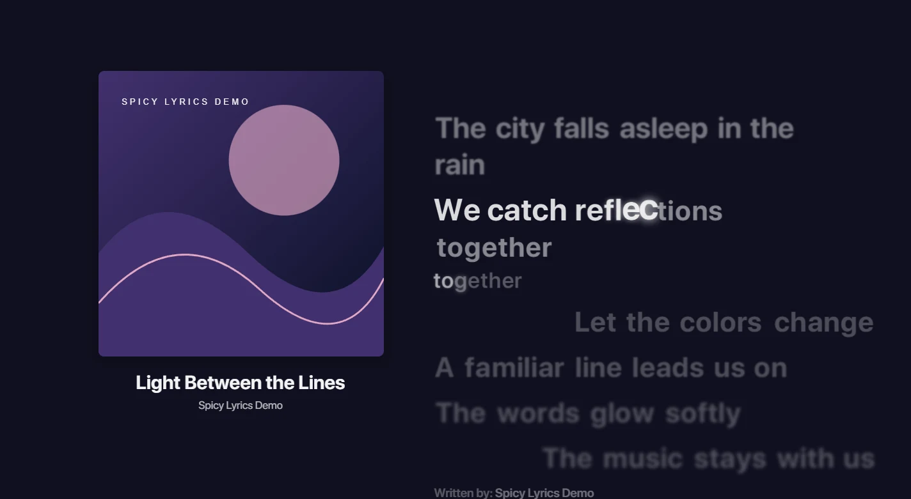
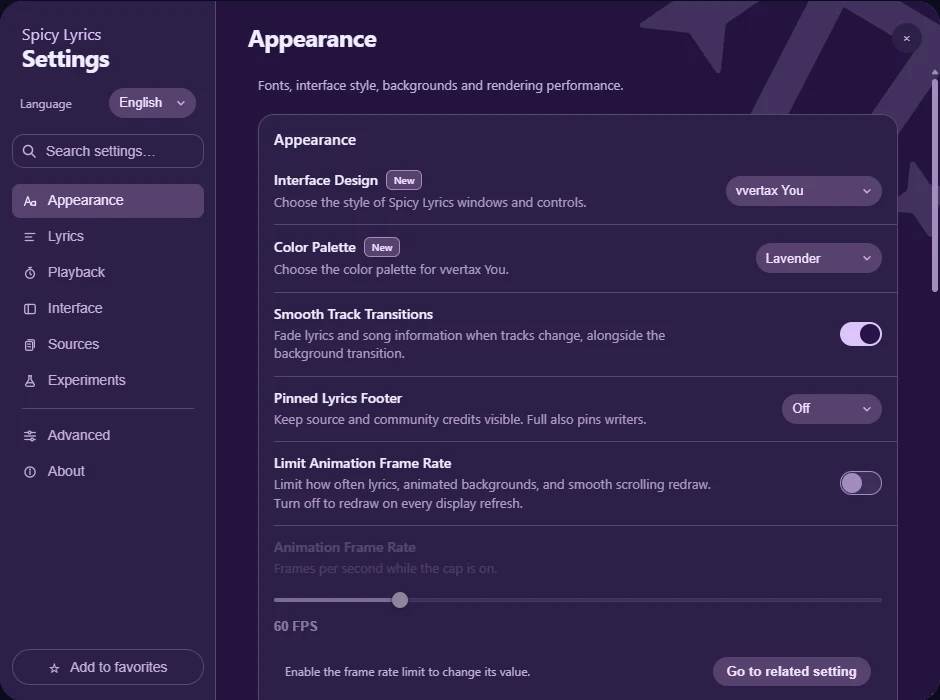
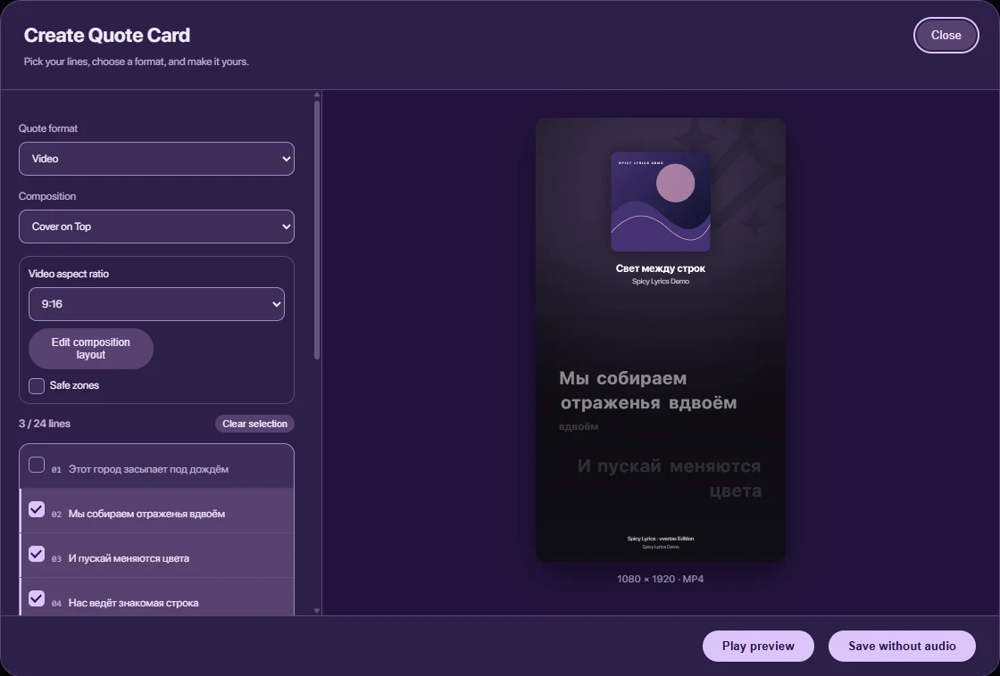

<p align="center">
  
</p>
<h1 align="center">Spicy Lyrics — vvertax Edition</h1>
<p align="center">Synced lyrics, customizable themes, and video quotes for desktop Spotify.</p>
<p align="center">
  <strong>An unofficial fork of <a href="https://github.com/Spikerko/spicy-lyrics">Spicy Lyrics by Spikerko</a>.</strong><br>
  Built for Spicetify with work from the <a href="https://github.com/iPixelGalaxy/spicy-lyrics">iPixelGalaxy</a> and <a href="https://github.com/Ruytha/spicy-lyrics-ruytha-edition">Ruytha</a> forks.
</p>
<p align="center">
  <strong>English</strong> · <a href="./README-Rus.md">Русский</a>
</p>
<p align="center">
  <a href="#installation"><strong>Install</strong></a> ·
  <a href="#lyrics-in-motion">Screenshots</a> ·
  <a href="https://github.com/vvertax/spicy-lyrics/blob/main/CHANGELOG.md">Changelog</a>
</p>



## Installation

You’ll need desktop Spotify and [Spicetify](https://spicetify.app). Disable any other Spicy Lyrics extension first.

1. Download [`spicy-lyrics-sl.mjs`](https://lrc.vvrtx.lol/spicy-lyrics-sl.mjs) and place it in the Spicetify **Extensions** folder. Run `spicetify -c` to locate your configuration file. The folder is beside it.
2. Run the following commands.

   ```powershell
   spicetify config extensions spicy-lyrics-sl.mjs
   spicetify apply
   ```

The loader selects **vvertax Edition** on first launch and checks for a new build whenever Spotify starts.

## Lyrics in motion

Follow words and syllables in time with the song, with duet lines and backing vocals. Browse Spotify with floating subtitles or open Cinema View for a larger lyrics display. Choose Spring or Bloom, switch lyrics sources, and toggle romanization when available.

## Make it yours

**vvertax You** brings Material You colors to the Original Spicy Lyrics settings layout. Pick Gray, Lavender, Green, or White, or generate your own palette from one HEX color. Change fonts, hide settings you rarely use, and drag pinned quick controls into the order you want.



## Video quotes

Create a PNG quote card or export an animated clip with up to 24 timed lines over 60 seconds. Trim and loop the preview, then choose a vertical, square, or widescreen frame. Move the cover and text in the preview, and add a local audio file or capture Spotify audio where sharing is supported. Video export supports MP4 and WebM, depending on the available encoder.



## Tools for lyric creators

- Import TTML or LRC for a track and back up your local lyrics library.
- Compare two TTML versions side by side at the same playback position.
- Leave notes on individual lines and export your review as a report.

*The screenshots come from the browser demo.*

## Build from source

Requires Node.js 24 and npm.

```sh
npm ci
npm test
npm run build
```

The build produces `dist/spicy-lyrics@<version>.mjs`. You can install it directly for a fixed local build.

## License

[AGPL v3](https://github.com/vvertax/spicy-lyrics/blob/main/LICENSE) · [Attribution](https://github.com/vvertax/spicy-lyrics/blob/main/NOTICE.md)
